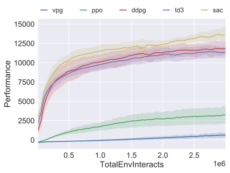
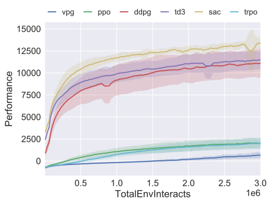
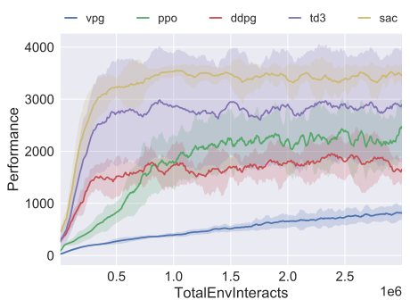
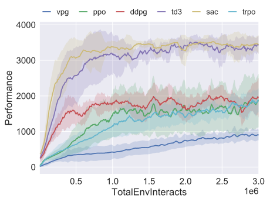
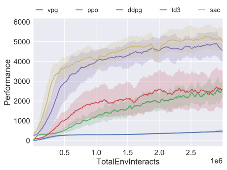
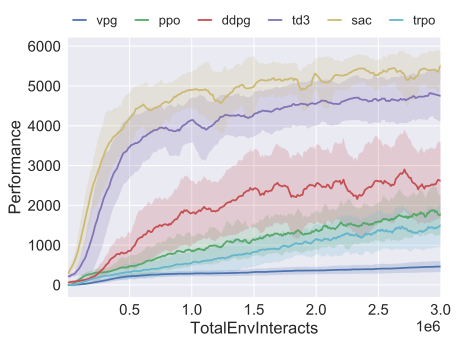
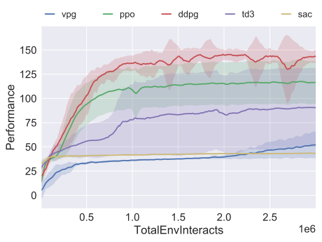
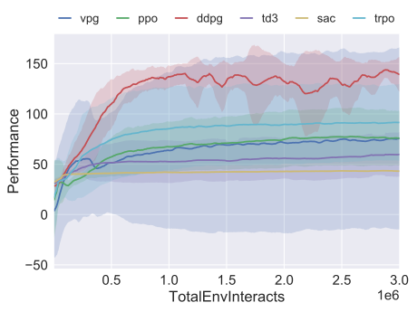
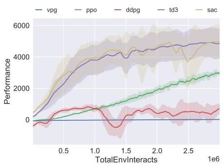
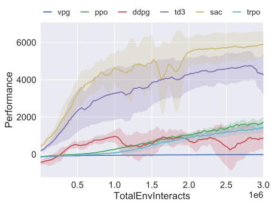

# Spinning Up 算法实现的基准测试

我们在 Gym 的 [MuJoCo](https://gym.openai.com/envs/#mujoco) 任务套件中选取了五种环境，对 Spinning Up 的算法实现进行了基准测试：HalfCheetah、Hopper、Walker2d、Swimmer 和 Ant。

## 各环境中的性能

### HalfCheetah：PyTorch 版本

*在 HalfCheetah-v3 上，使用 **PyTorch** 实现进行 300 万个时间步的基准测试。*

### HalfCheetah：TensorFlow 版本

*在 HalfCheetah-v3 上，使用 **TensorFlow** 实现进行 300 万个时间步的基准测试。*

### Hopper：PyTorch 版本

*在 Hopper-v3 上，使用 **PyTorch** 实现进行 300 万个时间步的基准测试。*

### Hopper：TensorFlow 版本

*在 Hopper-v3 上，使用 **TensorFlow** 实现进行 300 万个时间步的基准测试。*

### Walker2d：PyTorch 版本

*在 Walker2d-v3 上，使用 **PyTorch** 实现进行 300 万个时间步的基准测试。*

### Walker2d：TensorFlow 版本

*在 Walker2d-v3 上，使用 **TensorFlow** 实现进行 300 万个时间步的基准测试。*

### Swimmer：PyTorch 版本

*在 Swimmer-v3 上，使用 **PyTorch** 实现进行 300 万个时间步的基准测试。*

### Swimmer：TensorFlow 版本

*在 Swimmer-v3 上，使用 **TensorFlow** 实现进行 300 万个时间步的基准测试。*

### Ant：PyTorch 版本

*在 Ant-v3 上，使用 **PyTorch** 实现进行 300 万个时间步的基准测试。*

### Ant：TensorFlow 版本

*在 Ant-v3 上，使用 **TensorFlow** 实现进行 300 万个时间步的基准测试。*

## 实验细节

**随机种子。** 每项实验都使用 10 个不同的随机种子运行。图中展示训练过程中不同随机种子下性能的均值（实线）与标准差（阴影区域）。

**性能指标。** 对同策略（on-policy）算法，性能定义为每个 epoch 收集的一批轨迹的平均回报。对离策略（off-policy）算法，每经过 10,000 个时间步测量一次性能：使用确定性策略（对于 SAC，则使用均值策略），不添加动作噪声，运行 10 条轨迹，并报告这些测试轨迹的平均回报。

**网络架构。** 同策略算法的策略网络和价值函数网络均采用大小为 (64, 32) 的网络，使用 tanh 激活单元。离策略算法采用大小为 (256, 256) 的网络，使用 ReLU 激活单元。

**批大小。** 同策略算法每次批量更新前收集 4,000 步智能体与环境的交互数据。离策略算法在每次梯度下降时使用大小为 100 的小批量数据。

所有其他超参数均保留 Spinning Up 各算法实现的默认设置。详情请参阅各算法的文档页面。

学习曲线采用跨度为 11 个 epoch 的窗口取平均进行平滑。

> [!note] 你应该知道
> 与文献中的报告结果相比，Spinning Up 对 DDPG、TD3 和 SAC 的实现表现大致与这些算法报告的最佳结果处于同一水平。因此，可以将 Spinning Up 对这些算法的实现用于研究。
>
> Spinning Up 对 VPG、TRPO 和 PPO 的实现总体上比文献报告的这些算法的最佳结果略弱。这是由于我们的实现缺少一些标准技巧，例如观测值归一化和价值回归目标归一化。进行研究中的算法比较时，应该使用 [OpenAI Baselines](https://github.com/openai/baselines) 提供的 TRPO 或 PPO 实现。

## PyTorch 与 TensorFlow 的比较

以下页面提供了各算法 PyTorch 实现与 TensorFlow 实现之间的直接对比图：

- [VPG 直接对比](https://github.com/openai/spinningup/blob/master/docs/spinningup/bench_vpg.rst)
- [PPO 直接对比](https://github.com/openai/spinningup/blob/master/docs/spinningup/bench_ppo.rst)
- [DDPG 直接对比](https://github.com/openai/spinningup/blob/master/docs/spinningup/bench_ddpg.rst)
- [TD3 直接对比](https://github.com/openai/spinningup/blob/master/docs/spinningup/bench_td3.rst)
- [SAC 直接对比](https://github.com/openai/spinningup/blob/master/docs/spinningup/bench_sac.rst)
