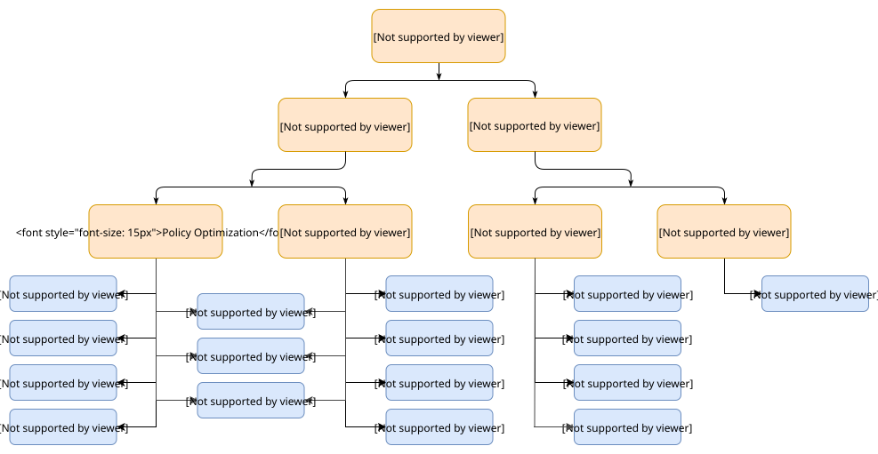

# 第二部分：强化学习算法的种类

现在，我们已经了解了强化学习术语和符号的基础知识，可以继续讨论一些更丰富的内容：现代强化学习算法的整体图景，以及算法设计中不同选择所涉及的权衡。

## 强化学习算法的分类

*现代强化学习算法的一种分类。它并不穷尽所有算法，但很有用。参见下方“分类图中的算法链接”一节。*

在开始本节之前，先说明一点：要为现代强化学习算法画出一个准确、全面的分类体系，实际上非常困难，因为算法的模块化特征很难通过树形结构充分表示。此外，为了把内容放到一页中，并让入门读者能够消化，我们不得不省略大量更高级的主题（探索、迁移学习、元学习等）。尽管如此，本节仍然希望：

- 强调深度强化学习算法设计中最基础的选择：学习什么，以及如何学习；
- 揭示不同选择之间的权衡；
- 根据这些选择，把一些重要的现代算法放到相应的背景中加以理解。

### 无模型与基于模型的强化学习

强化学习算法最重要的分类依据之一，就是 **智能体能否使用环境模型（或者能否学习环境模型）**。这里所说的环境模型，是指能够预测状态转移与奖励的函数。

拥有模型的主要好处是：\**智能体可以进行规划*\*。它可以提前推演一系列可能的选择会产生什么结果，再明确地比较这些选项。随后，智能体还可以把前瞻性规划的结果提炼成学到的策略。这类方法中一个非常著名的例子是 [AlphaZero](https://arxiv.org/abs/1712.01815)。当它起作用时，相比不使用模型的方法，样本效率可能显著提高。

主要缺点是：\**智能体通常无法获得环境的真实模型。*\* 在这种情况下，如果智能体希望使用模型，就只能完全依靠经验来学习模型，这又带来了多项挑战。其中最大的挑战是：智能体可能利用所学模型的偏差，最终得到一个在学习模型中表现很好、在真实环境中却并非最优（甚至极其糟糕）的智能体。模型学习本身就很困难，因此即使投入大量时间和计算资源，也可能收效甚微。

使用模型的算法称为 **基于模型（model-based）** 的方法，不使用模型的算法则称为 **无模型（model-free）** 的方法。无模型方法虽然放弃了使用模型可能获得的样本效率优势，但通常更容易实现和调参。在本文写作之时（2018 年 9 月），无模型方法比基于模型的方法更流行，也得到了更广泛的开发与测试。

### 学习什么

强化学习算法的另一个关键分类依据是：\**到底学习什么？*\* 常见的学习对象包括：

- 策略，可以是随机性策略，也可以是确定性策略；
- 动作价值函数（Q 函数）；
- 状态价值函数；
- 以及／或者环境模型。

#### 无模型强化学习中学习什么

无模型强化学习中，表示和训练智能体主要有两种方法。

**策略优化（Policy Optimization）。** 这一类方法用 $\pi_{\theta}(a|s)$ 显式表示策略。它们可以通过对性能目标 $J(\pi_{\theta})$ 进行梯度上升，直接优化参数 $\theta$；也可以通过最大化 $J(\pi_{\theta})$ 的局部近似，间接优化参数。这类优化几乎总是 **同策略（on-policy）** 的，也就是说，每次更新只使用执行最新版本策略时收集的数据。策略优化通常还会学习一个近似函数 $V_{\phi}(s)$，用来近似当前策略下的状态价值函数 $V^{\pi}(s)$，以辅助确定应该如何更新策略。

策略优化方法的例子包括：

- [A2C / A3C](https://arxiv.org/abs/1602.01783)：通过梯度上升直接最大化性能；
- [PPO](https://arxiv.org/abs/1707.06347)：通过最大化一个 *代理目标函数（surrogate objective）* 间接提高性能。这个代理目标函数对更新所引起的 $J(\pi_{\theta})$ 变化提供一种保守估计。

**Q 学习（Q-Learning）。** 这一类方法学习一个近似函数 $Q_{\theta}(s,a)$，用来近似最优动作价值函数 $Q^*(s,a)$。通常，它们使用基于 [Bellman equation](../spinningup/rl_intro_zh.md) 的目标函数进行学习。这类优化几乎总是 **异策略（off-policy）** 的，也就是说，每次更新可以使用训练过程中任意时刻收集的数据，而不必考虑当时智能体采用了怎样的探索行为。相应的策略由 $Q^*$ 与 $\pi^*$ 的联系得到：Q 学习智能体采取的动作为

$$a(s) = \arg \max_a Q_{\theta}(s,a).$$

Q 学习方法的例子包括：

- [DQN](https://www.cs.toronto.edu/~vmnih/docs/dqn.pdf)：这是推动深度强化学习领域兴起的经典方法；
- [C51](https://arxiv.org/abs/1707.06887)：一种学习回报分布的变体，该分布的期望值是 $Q^*$。

**策略优化与 Q 学习的权衡。** 策略优化方法的主要优势，是它们在原理上比较直接：\*直接优化你真正想要的目标\*。因此，它们通常更加稳定、可靠。相比之下，Q 学习通过训练 $Q_{\theta}$ 使其满足某个自洽方程，只是 *间接地* 优化智能体性能。这类学习存在许多失败模式，因此往往不够稳定。 不过，一旦 Q 学习能够奏效，它在样本效率上具有相当大的优势，因为它可以比策略优化方法更有效地重复利用数据。

**策略优化与 Q 学习之间的过渡方法。** 幸运的是，策略优化和 Q 学习并不互相排斥（在某些条件下，二者甚至是 [equivalent](https://arxiv.org/abs/1704.06440) 的），因此存在一系列位于两个极端之间的算法。这些算法能够审慎地权衡两者各自的长处和短处。例如：

- [DDPG](https://arxiv.org/abs/1509.02971)：同时学习一个确定性策略和一个 Q 函数，利用二者相互促进；
- [SAC](https://arxiv.org/abs/1801.01290)：使用随机性策略、熵正则化及一些其他技巧来稳定学习，并在标准基准任务上取得比 DDPG 更高的成绩。
- 文献 1： 如果想进一步了解 Q 学习方法为何以及如何失败，可以参阅：1）[Tsitsiklis and van Roy](http://web.mit.edu/jnt/www/Papers/J063-97-bvr-td.pdf) 的经典论文；2）[review by Szepesvari](https://sites.ualberta.ca/~szepesva/papers/RLAlgsInMDPs.pdf)（较新的综述，尤其是第 4.3.2 节）；以及 3）[Sutton and Barto](https://drive.google.com/file/d/1xeUDVGWGUUv1-ccUMAZHJLej2C7aAFWY/view) 第 11 章，特别是第 11.3 节。其中介绍了函数逼近、自举和异策略数据组成的“致命三角”，它们共同导致价值学习算法不稳定。

### 基于模型的强化学习中学习什么

与无模型强化学习不同，基于模型的强化学习没有少数几个容易清楚划分的方法类别：使用模型有许多相互独立的方式。下面给出一些例子，但远非完整清单。对于每一种方式，模型既可以预先给定，也可以通过学习得到。

**背景：纯规划（Pure Planning）。** 最基本的方式 *完全不* 显式表示策略，而是利用 [model-predictive control](https://en.wikipedia.org/wiki/Model_predictive_control)（模型预测控制，MPC）等纯规划技术来选择动作。在 MPC 中，每次智能体观测环境时，都会根据模型计算一个最优计划。这个计划描述从当前时刻开始，在某个固定时间窗口内要采取的所有动作。（规划算法还可以借助学习到的价值函数，考虑规划时域之外的未来奖励。）然后，智能体只执行计划中的第一个动作，立即丢弃其余部分。每次即将与环境交互时，它都会重新计算一个计划，以避免使用规划时域已经短于预期的旧计划中的动作。

- [MBMF](https://sites.google.com/view/mbmf) 工作探索了在若干标准深度强化学习基准任务中，使用学到的环境模型进行 MPC。

**专家迭代（Expert Iteration）。** 对纯规划的一种直接扩展，是显式表示并学习策略 $\pi_{\theta}(a|s)$。智能体在模型中使用一种规划算法（例如蒙特卡洛树搜索），通过当前策略采样，为规划过程生成候选动作。规划算法最后给出的动作，会优于单独依靠策略所能给出的动作，因此，相对于该策略，规划算法就相当于一名“专家”。随后更新策略，使其产生的动作更接近规划算法的输出。

- [ExIt](https://arxiv.org/abs/1705.08439) 算法采用这种方式训练深度神经网络玩 Hex 棋。
- [AlphaZero](https://arxiv.org/abs/1712.01815) 也是这种方法的一个例子。

**为无模型方法扩充数据（Data Augmentation for Model-Free Methods）。** 使用无模型强化学习算法训练策略或 Q 函数，但更新智能体时：1）在真实经验中加入虚构经验；或者 2）\*仅\* 使用虚构经验。

- [MBVE](https://arxiv.org/abs/1803.00101) 展示了在真实经验中加入虚构经验的例子。
- [World Models](https://worldmodels.github.io/) 展示了完全使用虚构经验训练智能体的例子；作者将其称为“在梦中训练”。

**将规划循环嵌入策略（Embedding Planning Loops into Policies）。** 另一种方式，是把规划过程直接作为子程序嵌入策略中，从而把完整计划作为策略的辅助信息，再使用任何标准无模型算法训练策略的输出。这种框架的关键，是策略可以学会自己决定何时以及如何使用这些计划。于是，模型偏差就不那么严重了：如果某些状态下的模型不适合进行规划，策略可以直接学会忽略它。

- [I2A](https://arxiv.org/abs/1707.06203) 是为智能体赋予这类想象能力的一个例子。

## 分类图中的算法链接

- [A2C / A3C](https://arxiv.org/abs/1602.01783)（异步优势演员-评论家）：Mnih 等，2016
- [PPO](https://arxiv.org/abs/1707.06347)（近端策略优化）：Schulman 等，2017
- [TRPO](https://arxiv.org/abs/1502.05477)（信赖域策略优化）：Schulman 等，2015
- [DDPG](https://arxiv.org/abs/1509.02971)（深度确定性策略梯度）：Lillicrap 等，2015
- [TD3](https://arxiv.org/abs/1802.09477)（双延迟 DDPG）：Fujimoto 等，2018
- [SAC](https://arxiv.org/abs/1801.01290)（软演员-评论家）：Haarnoja 等，2018
- [DQN](https://www.cs.toronto.edu/~vmnih/docs/dqn.pdf)（深度 Q 网络）：Mnih 等，2013
- [C51](https://arxiv.org/abs/1707.06887)（分类式 51 原子 DQN）：Bellemare 等，2017
- [QR-DQN](https://arxiv.org/abs/1710.10044)（分位数回归 DQN）：Dabney 等，2017
- [HER](https://arxiv.org/abs/1707.01495)（事后经验回放）：Andrychowicz 等，2017
- [World Models](https://worldmodels.github.io/)：Ha 和 Schmidhuber，2018
- [I2A](https://arxiv.org/abs/1707.06203)（想象增强智能体）：Weber 等，2017
- [MBMF](https://sites.google.com/view/mbmf)（基于模型的强化学习加无模型微调）：Nagabandi 等，2017
- [MBVE](https://arxiv.org/abs/1803.00101)（基于模型的价值扩展）：Feinberg 等，2018
- [AlphaZero](https://arxiv.org/abs/1712.01815)：Silver 等，2017
