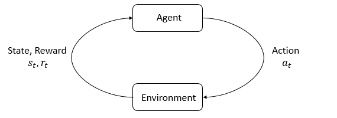

# 第一部分：强化学习中的关键概念


欢迎阅读我们的强化学习入门教程！在这里，我们希望帮助你熟悉：

- 讨论强化学习时使用的语言和符号；
- 从整体上理解强化学习算法在做什么（不过，我们基本上不讨论它们\*如何\*做到这一点）；
- 以及支撑这些算法的一小部分核心数学知识。

简单来说，强化学习研究的是智能体，以及智能体如何通过试错进行学习。它把这样一个想法形式化了：通过奖励或惩罚一个智能体的行为，可以使它在未来更有可能重复该行为，或者避免再次做出该行为。

## 强化学习能做什么？

近年来，强化学习方法在许多领域取得了成功。例如，人们已经用它教会计算机在模拟环境中控制机器人……

<video autoplay="" src="https://d4mucfpksywv.cloudfront.net/openai-baselines-ppo/knocked-over-stand-up.mp4" loop="" controls="" style="display: block; margin-left: auto; margin-right: auto; margin-bottom:1.5em; width: 100%; max-width: 720px; max-height: 80vh;">
</video>

……以及在现实世界中控制机器人……

<div style="position: relative; padding-bottom: 56.25%; height: 0; overflow: hidden; max-width: 100%; height: auto;">
    <iframe src="https://www.youtube.com/embed/jwSbzNHGflM?ecver=1" frameborder="0" allowfullscreen style="position: absolute; top: 0; left: 0; width: 100%; height: 100%;"></iframe>
</div>
<br />

它还因创造能够玩复杂策略游戏的突破性人工智能而闻名，其中最著名的是 [围棋](https://deepmind.com/research/alphago/) 和 [Dota](https://blog.openai.com/openai-five/)。此外，人们还用强化学习让计算机仅凭原始像素[玩雅达利游戏](https://deepmind.com/research/dqn/)，并训练模拟机器人[遵循人类指令](https://blog.openai.com/deep-reinforcement-learning-from-human-preferences/)。

## 关键概念和术语



*智能体与环境之间的交互循环。*


强化学习中的两个主角是 **智能体（agent）** 和 **环境（environment）**。环境是智能体所处并与之交互的世界。在每一步交互中，智能体都会看到世界状态的一个观测（这个观测可能是不完整的），然后决定采取什么动作。智能体行动时，环境会随之发生变化，但环境也可能自行变化。

智能体还会从环境中感知到一个 **奖励（reward）** 信号。这是一个数字，用来告诉智能体当前世界状态有多好或多坏。智能体的目标是最大化累积奖励，这个累积奖励称为 **回报（return）**。强化学习方法就是使智能体能够学会实现这一目标的行为的方法。

为了更具体地讨论强化学习在做什么，我们还需要引入一些术语。我们需要讨论：

- 状态与观测；
- 动作空间；
- 策略；
- 轨迹；
- 回报的不同定义方式；
- 强化学习优化问题；
- 以及价值函数。

### 状态与观测

**状态（state）** $s$ 是对世界状况的完整描述。状态中不遗漏任何有关世界的信息。\**观测（observation）*\* $o$ 则是状态的部分描述，因此可能遗漏一些信息。

在深度强化学习中，我们几乎总是用[实数值向量、矩阵或更高阶的张量](https://en.wikipedia.org/wiki/Real_coordinate_space) 来表示状态和观测。例如，视觉观测可以用像素值组成的 RGB 矩阵来表示；机器人的状态则可以用关节角度和速度来表示。

当智能体能够观测到环境的完整状态时，我们称环境是 **完全可观测的（fully observed）**。当智能体只能看到状态的一部分时，我们称环境是 **部分可观测的（partially observed）**。

> [!note] 你应该知道
> 强化学习的数学符号有时会在严格来说更应该使用观测符号 $o$ 的地方，使用状态符号 $s$。特别是在讨论智能体如何决定动作时，经常会用符号表示动作以状态为条件，而实际情况可能是：智能体无法得到完整状态，动作只能以观测为条件。
>
> 在本指南中，我们会遵循通用的符号约定，但应当能从上下文看出实际指的是状态还是观测。如果某处仍然不清楚，欢迎提出 issue！我们的目标是教学，而不是制造困惑。


### 动作空间

不同环境允许执行的动作也不同。在特定环境中，所有有效动作构成的集合通常称为 **动作空间（action space）**。一些环境，例如雅达利游戏和围棋，拥有 **离散动作空间（discrete action spaces）**，也就是说，智能体只能从有限个动作中选择。另一些环境，例如机器人在物理世界中进行控制的环境，拥有 **连续动作空间（continuous action spaces）**。在连续空间中，动作是实数值向量。

这种区别对深度强化学习方法有相当深远的影响。有些算法类别只能直接应用于其中一种情况；如果要应用于另一种情况，就必须进行大幅修改。

### 策略

**策略（policy）** 是智能体用来决定采取什么动作的一条规则。策略可以是确定性的，此时通常用 $\mu$ 表示：

$$a_t = \mu(s_t),$$

也可以是随机性的，此时通常用 $\pi$ 表示：

$$a_t \sim \pi(\cdot | s_t).$$

由于策略本质上是智能体的“大脑”，人们经常用“策略”一词来代替“智能体”。例如，会说“这个策略试图最大化奖励”。

在深度强化学习中，我们处理的是 **参数化策略（parameterized policies）**：其输出由依赖一组参数的可计算函数给出。参数可以是神经网络的权重和偏置等，我们可以通过某种优化算法调整参数，从而改变策略的行为。

我们通常用 $\theta$ 或 $\phi$ 表示这类策略的参数，并把它写成策略符号的下标，以强调二者之间的关系：

$$\begin{aligned}
a_t &= \mu_{\theta}(s_t) \\
a_t &\sim \pi_{\theta}(\cdot | s_t).
\end{aligned}$$

#### 确定性策略

**示例：确定性策略。** 下面的代码展示了如何使用 PyTorch 的 <span class="title-ref">torch.nn</span> 包，为连续动作空间构建一个简单的确定性策略：

``` python
pi_net = nn.Sequential(
              nn.Linear(obs_dim, 64),
              nn.Tanh(),
              nn.Linear(64, 64),
              nn.Tanh(),
              nn.Linear(64, act_dim)
            )
```

这段代码构建了一个多层感知机（MLP）网络，它有两个大小为 64 的隐藏层，并使用 $\tanh$ 激活函数。如果 <span class="title-ref">obs</span> 是一个包含一批观测的 NumPy 数组，那么可以像下面这样使用 <span class="title-ref">pi_net</span> 得到一批动作：

``` python
obs_tensor = torch.as_tensor(obs, dtype=torch.float32)
actions = pi_net(obs_tensor)
```

> [!note] 你应该知道
> 如果你不熟悉这些神经网络知识，也不用担心。本教程重点介绍强化学习，而不是神经网络本身。因此，你可以先跳过这个例子，之后再回来阅读。不过我们认为，如果你已经了解神经网络，这个例子可能会有所帮助。


#### 随机性策略

深度强化学习中最常见的两种随机性策略是 **分类策略（categorical policies）** 和 **对角高斯策略（diagonal Gaussian policies）**。

[Categorical](https://en.wikipedia.org/wiki/Categorical_distribution)（分类）策略可用于离散动作空间，而对角 [Gaussian](https://en.wikipedia.org/wiki/Multivariate_normal_distribution)（高斯）策略则用于连续动作空间。

使用和训练随机性策略时，有两项计算极其重要：

- 从策略中采样动作；
- 计算特定动作的对数似然，即 $\log \pi_{\theta}(a|s)$。

下面，我们将说明如何针对分类策略和对角高斯策略分别完成这些计算。

> [!note] 分类策略
> 分类策略类似于对离散动作进行分类的分类器。你可以用与构建分类器相同的方式，为分类策略构建神经网络：输入是观测，接下来是若干层网络（根据输入类型，可以使用卷积层或全连接层），最后是一个线性层，为每个动作输出一个 logit，然后通过 [softmax](https://developers.google.com/machine-learning/crash-course/multi-class-neural-networks/softmax) 将这些 logits 转换为概率。
>
> **采样。** 得到每个动作的概率后，PyTorch 和 TensorFlow 等框架都内置了采样工具。例如，可以参阅 [PyTorch 中的 Categorical 分布](https://pytorch.org/docs/stable/distributions.html#categorical)、[torch.multinomial](https://pytorch.org/docs/stable/torch.html#torch.multinomial)、[tf.distributions.Categorical](https://www.tensorflow.org/versions/r1.15/api_docs/python/tf/distributions/Categorical) 或 [tf.multinomial](https://www.tensorflow.org/versions/r1.15/api_docs/python/tf/random/multinomial) 的文档。
>
> **对数似然。** 将最后一层输出的概率表示为 $P_{\theta}(s)$。这是一个向量，其元素个数等于动作数，因此我们可以将动作当作向量下标。于是，动作 $a$ 的对数似然可以通过索引该向量获得：
>
> $$\log \pi_{\theta}(a|s) = \log \left[P_{\theta}(s)\right]_a.$$


> [!note] 对角高斯策略
> 多元高斯分布（也称多元正态分布）由均值向量 $\mu$ 和协方差矩阵 $\Sigma$ 描述。对角高斯分布是其中一种特殊情况，它的协方差矩阵只有对角线上有非零元素。因此，我们可以用一个向量来表示它。
>
> 对角高斯策略总会使用一个神经网络，将观测映射为动作均值 $\mu_{\theta}(s)$。协方差矩阵通常有两种表示方式。
>
> **第一种方式：** 使用一个对数标准差向量 $\log \sigma$，它 **不是** 状态的函数：这些 $\log \sigma$ 是独立存在的参数。（你应该知道：我们对 VPG、TRPO 和 PPO 的实现采用的就是这种方式。）
>
> **第二种方式：** 使用一个神经网络，将状态映射为对数标准差 $\log \sigma_{\theta}(s)$。这个网络可以选择与均值网络共享部分层。
>
> 注意，在这两种方式中，我们输出的都是对数标准差，而不是直接输出标准差。这是因为对数标准差可以在 $(-\infty,\infty)$ 范围内取任意值，而标准差必须非负。如果不必强制参数满足这类约束，训练就会更容易。通过取指数，我们可以立即从对数标准差得到标准差，因此这种表示方法不会损失任何信息。
>
> **采样。** 给定动作均值 $\mu_{\theta}(s)$、标准差 $\sigma_{\theta}(s)$，以及从球形高斯分布采样得到的噪声向量 $z$（即 $z \sim \mathcal{N}(0,I)$），可以按下面的方式计算动作样本：
>
> $$a = \mu_{\theta}(s) + \sigma_{\theta}(s) \odot z,$$
>
> 其中，$\odot$ 表示两个向量的逐元素乘法。常见框架都提供了生成噪声向量的内置方法，例如 [torch.normal](https://pytorch.org/docs/stable/torch.html#torch.normal) 或 [tf.random_normal](https://www.tensorflow.org/versions/r1.15/api_docs/python/tf/random/normal)。你也可以构建分布对象，例如通过 [torch.distributions.Normal](https://pytorch.org/docs/stable/distributions.html#normal) 或 [tf.distributions.Normal](https://www.tensorflow.org/versions/r1.15/api_docs/python/tf/distributions/Normal)，然后用这些对象生成样本。（后者的优点是，分布对象还可以为你计算对数似然。）
>
> **对数似然。** 对于一个 $k$ 维动作 $a$，若对角高斯分布的均值为 $\mu = \mu_{\theta}(s)$，标准差为 $\sigma = \sigma_{\theta}(s)$，则对数似然为：
>
> $$\log \pi_{\theta}(a|s) = -\frac{1}{2}\left(\sum_{i=1}^k \left(\frac{(a_i - \mu_i)^2}{\sigma_i^2} + 2 \log \sigma_i \right) + k \log 2\pi \right).$$


### 轨迹

一条 **轨迹（trajectory）** $\tau$ 是世界中的一串状态与动作：

$$\tau = (s_0, a_0, s_1, a_1, ...).$$

世界的第一个状态 $s_0$，从 **初始状态分布（start-state distribution）** 中随机采样得到。这个分布有时表示为 $\rho_0$：

$$s_0 \sim \rho_0(\cdot).$$

**状态转移（state transitions）** 指的是从时刻 $t$ 的世界状态 $s_t$ 到时刻 $t+1$ 的世界状态 $s_{t+1}$ 之间发生的变化。状态转移由环境的自然规律控制，并且只依赖于最近一次动作 $a_t$。它可以是确定性的：

$$s_{t+1} = f(s_t, a_t)$$

也可以是随机性的：

$$s_{t+1} \sim P(\cdot|s_t, a_t).$$

智能体按照自己的策略产生动作。

> [!note] 你应该知道
> 轨迹也经常称为 **episode**（回合）或 **rollout**（轨迹展开）。


### 奖励与回报

奖励函数 $R$ 在强化学习中极其重要。它依赖于当前世界状态、刚刚采取的动作，以及接下来的世界状态：

$$r_t = R(s_t, a_t, s_{t+1})$$

不过，人们经常把它简化为只依赖当前状态的形式，即 $r_t = R(s_t)$，或者依赖状态和动作二者的形式，即 $r_t = R(s_t,a_t)$。

智能体的目标是在一条轨迹上最大化某种意义下的累积奖励，但这个目标实际上可以有不同的理解方式。我们统一用 $R(\tau)$ 表示这些情况下的回报；其具体含义要么可以从上下文看出来，要么并不重要（因为同一套等式适用于所有这些情况）。

一种回报是 **有限时域、无折扣回报（finite-horizon undiscounted return）**：它就是固定步数窗口中获得的奖励之和。

$$R(\tau) = \sum_{t=0}^T r_t.$$

另一种回报是 **无限时域、折扣回报（infinite-horizon discounted return）**：它把智能体在未来所有时间获得的奖励相加，但是会根据奖励发生在多远的未来，对其进行折扣。这种回报形式包含折扣因子 $\gamma \in (0,1)$：

$$R(\tau) = \sum_{t=0}^{\infty} \gamma^t r_t.$$

但为什么我们需要折扣因子呢？我们难道不是想得到 *所有* 奖励吗？的确如此，不过折扣因子既符合直觉，在数学上又很方便。从直觉上说，现在拿到的钱比以后拿到的钱更好。从数学上说，无限时域的奖励总和[可能不会收敛](https://en.wikipedia.org/wiki/Convergent_series) 到有限值，而且在公式中也不容易处理。但在加入折扣因子后，在合理条件下，这个无限和就会收敛。

> [!note] 你应该知道
> 虽然在强化学习的形式化定义中，这两种回报之间的界限相当清晰，但在深度强化学习实践中，这条界限往往会变得模糊。例如，我们经常把算法设置为优化无折扣回报，却在估计 **价值函数** 时使用折扣因子。


### 强化学习问题

无论选择哪一种回报衡量方式（无限时域折扣回报或有限时域无折扣回报），也无论选择哪一种策略，强化学习的目标始终是：选择一个策略，使智能体按照这个策略行动时的 **期望回报** 最大化。

为了讨论期望回报，我们首先需要讨论轨迹上的概率分布。

假设环境转移和策略都是随机性的。那么，一条包含 $T$ 个时间步的轨迹的概率为：

$$P(\tau|\pi) = \rho_0 (s_0) \prod_{t=0}^{T-1} P(s_{t+1} | s_t, a_t) \pi(a_t | s_t).$$

随后，期望回报（无论采用上述哪种回报形式）记为 $J(\pi)$，其表达式为：

$$J(\pi) = \int_{\tau} P(\tau|\pi) R(\tau) = \mathbb{E}_{\tau\sim \pi}\left[R(\tau)\right].$$

因此，强化学习的核心优化问题可以写为：

$$\pi^* = \arg \max_{\pi} J(\pi),$$

其中，$\pi^*$ 是 **最优策略（optimal policy）**。

### 价值函数

了解一个状态或一个状态—动作对的 **价值（value）**，通常很有帮助。这里的价值是指：如果从该状态或状态—动作对出发，此后始终按照某个特定策略行动，所能获得的期望回报。几乎所有强化学习算法都会以某种方式使用 **价值函数（value functions）**。

这里有四个值得注意的主要函数。

1.  **给定策略下的状态价值函数（On-Policy Value Function）** $V^{\pi}(s)$，表示从状态 $s$ 出发、此后始终按照策略 $\pi$ 行动时的期望回报：

    > $$V^{\pi}(s) = \mathbb{E}_{\tau \sim \pi}\left[R(\tau)\left| s_0 = s\right.\right]$$

2.  **给定策略下的动作价值函数（On-Policy Action-Value Function）** $Q^{\pi}(s,a)$，表示从状态 $s$ 出发，先采取任意指定动作 $a$（这个动作不一定来自策略），此后始终按照策略 $\pi$ 行动时的期望回报：

    > $$Q^{\pi}(s,a) = \mathbb{E}_{\tau \sim \pi}\left[R(\tau)\left| s_0 = s, a_0 = a\right.\right]$$

3.  **最优状态价值函数（Optimal Value Function）** $V^*(s)$，表示从状态 $s$ 出发，此后始终按照环境中的 *最优* 策略行动时的期望回报：

    > $$V^*(s) = \max_{\pi} \mathbb{E}_{\tau \sim \pi}\left[R(\tau)\left| s_0 = s\right.\right]$$

4.  **最优动作价值函数（Optimal Action-Value Function）** $Q^*(s,a)$，表示从状态 $s$ 出发，先采取任意指定动作 $a$，此后始终按照环境中的 *最优* 策略行动时的期望回报：

    > $$Q^*(s,a) = \max_{\pi} \mathbb{E}_{\tau \sim \pi}\left[R(\tau)\left| s_0 = s, a_0 = a\right.\right]$$

> [!note] 你应该知道
> 当我们讨论价值函数却没有明确提到时间依赖关系时，所指的只是期望 **无限时域折扣回报**。如果是有限时域、无折扣回报，相应的价值函数还需要把时间作为一个参数。你能想出这是为什么吗？提示：当时间用完时会发生什么？


> [!note] 你应该知道
> 价值函数与动作价值函数之间有两个非常重要、而且经常出现的联系：
>
> $$V^{\pi}(s) = \mathbb{E}_{a\sim \pi}\left[Q^{\pi}(s,a)\right],$$
>
> 以及
>
> $$V^*(s) = \max_a Q^* (s,a).$$
>
> 这些关系都可以直接从刚才给出的定义推导出来。你能证明它们吗？


### 最优 Q 函数与最优动作

最优动作价值函数 $Q^*(s,a)$ 与最优策略选择的动作之间，存在一个重要联系。根据定义，$Q^*(s,a)$ 表示从状态 $s$ 开始，先采取（任意指定的）动作 $a$，然后始终按照最优策略行动所能得到的期望回报。

在状态 $s$ 下，最优策略会选择那个使从 $s$ 出发的期望回报最大的动作。因此，如果我们已经知道 $Q^*$，就可以通过下面的式子直接得到最优动作 $a^*(s)$：

$$a^*(s) = \arg \max_a Q^* (s,a).$$

注意：可能有多个动作同时使 $Q^*(s,a)$ 达到最大值。在这种情况下，这些动作都是最优动作，而最优策略可以从中随机选择任意一个。但总是存在一个确定性地选择动作的最优策略。

### 贝尔曼方程

上述四种价值函数都遵循一些特殊的自洽方程，称为 **贝尔曼方程（Bellman equations）**。贝尔曼方程背后的基本思想是：

> 起点的价值，等于你预计在起点获得的奖励，加上下一步到达之处的价值。

给定策略下，价值函数对应的贝尔曼方程为：

<span nowrap="">$$\begin{aligned}
\begin{align*}
V^{\pi}(s) &= \mathbb{E}_{a \sim \pi \\ s'\sim P}\left[r(s,a) + \gamma V^{\pi}(s')\right], \\
Q^{\pi}(s,a) &= \mathbb{E}_{s'\sim P}\left[r(s,a) + \gamma \mathbb{E}_{a'\sim \pi}\left[Q^{\pi}(s',a')\right]\right],
\end{align*}
\end{aligned}$$</span>

其中，$s' \sim P$ 是 $s' \sim P(\cdot |s,a)$ 的简写，表示下一状态 $s'$ 根据环境的转移规则进行采样；$a \sim \pi$ 是 $a \sim \pi(\cdot|s)$ 的简写；$a' \sim \pi$ 则是 $a' \sim \pi(\cdot|s')$ 的简写。

最优价值函数的贝尔曼方程为：

<span nowrap="">$$\begin{aligned}
\begin{align*}
V^*(s) &= \max_a \mathbb{E}_{s'\sim P}\left[r(s,a) + \gamma V^*(s')\right], \\
Q^*(s,a) &= \mathbb{E}_{s'\sim P}\left[r(s,a) + \gamma \max_{a'} Q^*(s',a')\right].
\end{align*}
\end{aligned}$$</span>

给定策略下的价值函数与最优价值函数对应的贝尔曼方程之间，最关键的区别就是：有没有对动作取 $\max$。加入这个最大化操作，反映了这样的事实：只要智能体可以选择动作，那么为了达到最优，它就必须选择能够带来最高价值的动作。

> [!note] 你应该知道
> 强化学习文献经常使用“Bellman backup（贝尔曼备份）”这个术语。对于一个状态或状态—动作对，贝尔曼备份指的是贝尔曼方程右侧的量，即奖励加上下一状态的价值。


### 优势函数

有时在强化学习中，我们并不需要从绝对意义上描述一个动作有多好，而只需要知道：它比其他动作的平均水平好多少。换句话说，我们想知道这个动作的相对 **优势（advantage）**。我们用 **优势函数（advantage function）** 对这个概念作出精确定义。

与策略 $\pi$ 对应的优势函数 $A^{\pi}(s,a)$，描述的是：假定之后始终按照策略 $\pi$ 行动，那么在状态 $s$ 下选择某个特定动作 $a$，比按照 $\pi(\cdot|s)$ 随机选择一个动作好多少。从数学上说，优势函数定义为：

$$A^{\pi}(s,a) = Q^{\pi}(s,a) - V^{\pi}(s).$$

> [!note] 你应该知道
> 我们以后还会进一步讨论这一点，但优势函数对策略梯度方法至关重要。


## （可选）形式化定义

到目前为止，我们一直以非形式化的方式讨论智能体所处的环境。不过，如果你查阅相关文献，很可能会遇到描述这类问题时使用的标准数学形式：\**马尔可夫决策过程（Markov Decision Processes，MDPs）*\*。一个 MDP 是一个五元组 $\langle S, A, R, P, \rho_0 \rangle$，其中：

- $S$ 是所有有效状态的集合；
- $A$ 是所有有效动作的集合；
- $R : S \times A \times S \to \mathbb{R}$ 是奖励函数，并且 $r_t = R(s_t, a_t, s_{t+1})$；
- $P : S \times A \to \mathcal{P}(S)$ 是转移概率函数，其中 $P(s'|s,a)$ 表示：如果从状态 $s$ 出发并采取动作 $a$，转移到状态 $s'$ 的概率；
- $\rho_0$ 是初始状态分布。

“马尔可夫决策过程”这个名称，来自该系统满足[马尔可夫性质](https://en.wikipedia.org/wiki/Markov_property)：状态转移只依赖最近的状态和动作，而不依赖更早的历史。
